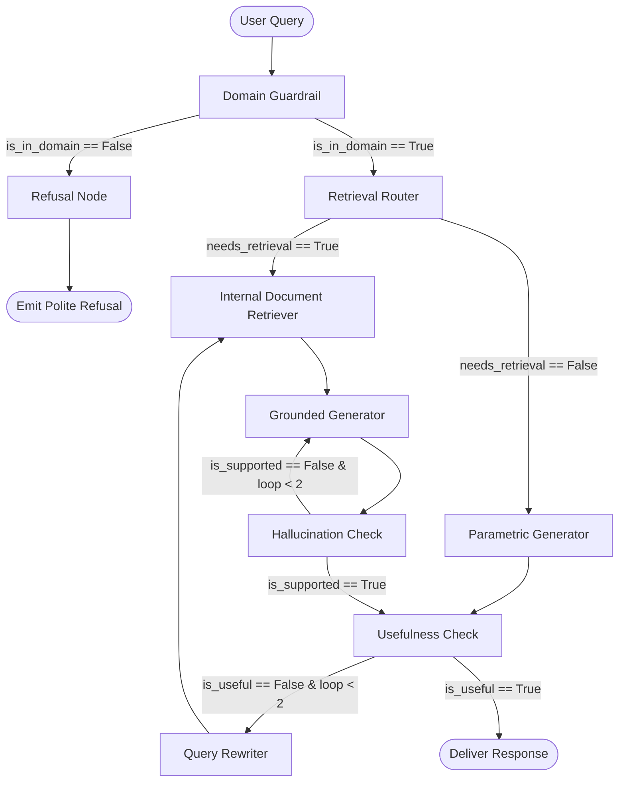
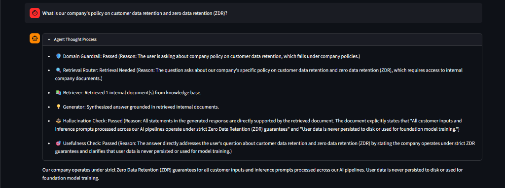
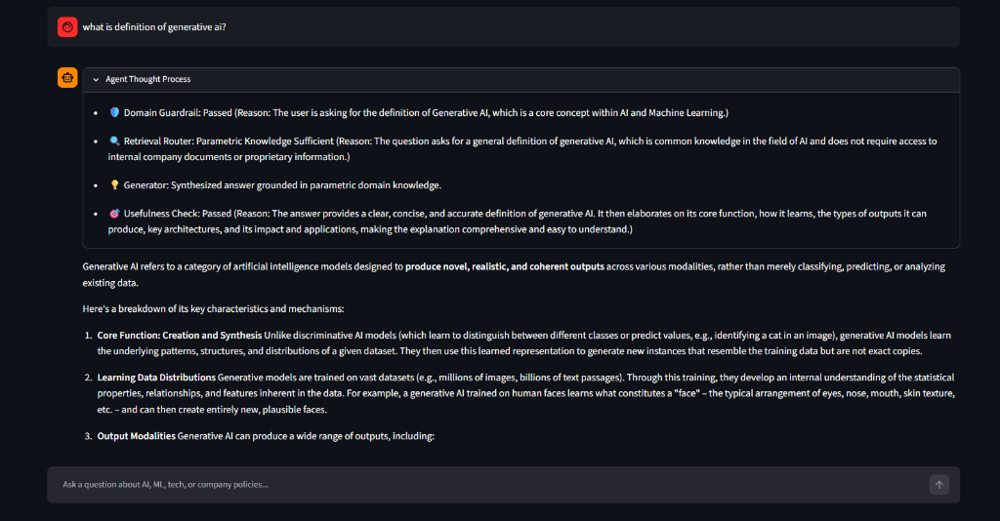
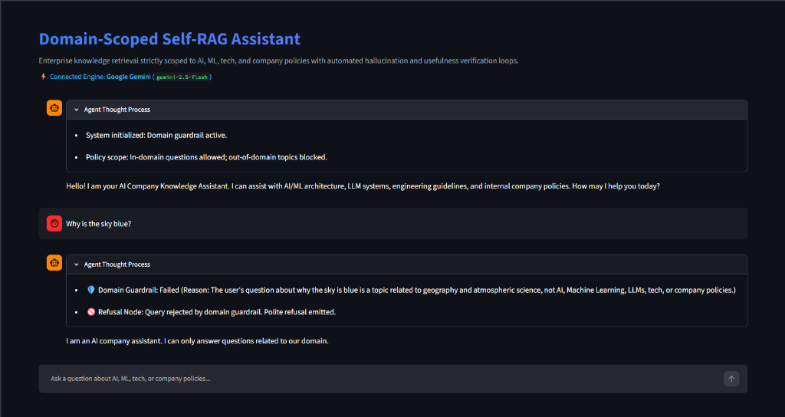
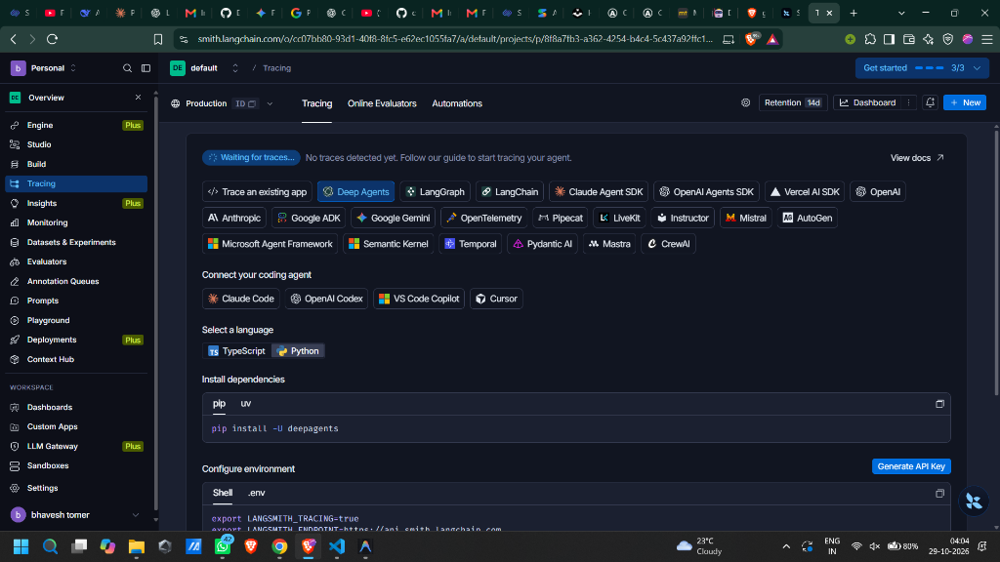
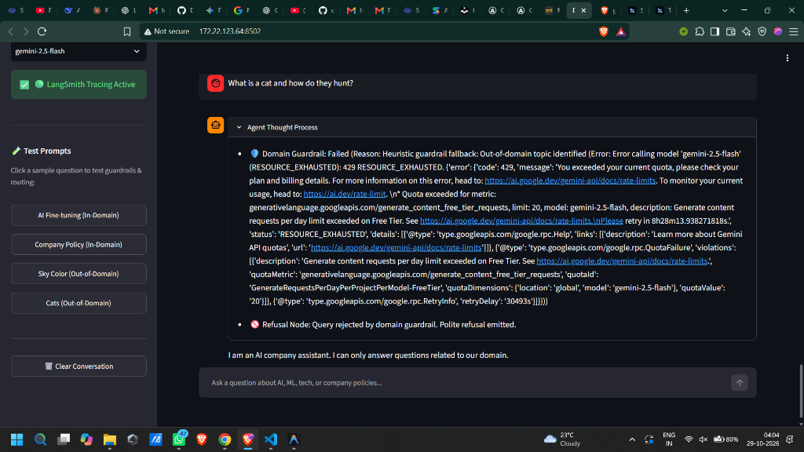

# 🛡️ Domain-Scoped Self-RAG Knowledge Assistant

[](https://www.python.org/downloads/)
[](https://github.com/langchain-ai/langgraph)
[](https://github.com/langchain-ai/langchain)
[](https://streamlit.io/)
[](https://smith.langchain.com/)
[](https://ai.google.dev/)
[](https://openai.com/)

A production-grade, enterprise AI knowledge assistant engineered with **LangGraph**, **LangChain**, **Pydantic Structured Outputs**, **LangSmith Observability**, and **Streamlit**. 

The system implements a **Domain-Scoped Self-RAG** architecture that actively checks domain boundaries, routes between parametric LLM knowledge and enterprise retrieval, eliminates hallucinations via grounded verification loops, and provides total auditability via real-time thought-process inspection.

---

## 🌟 Key Features

- **Strict Domain Boundary Guardrail**: Classifies every query using Pydantic structured output (`DomainCheck`). Out-of-domain questions are immediately halted with polite refusals.
- **Adaptive Retrieval Router**: Determines whether questions require proprietary internal documentation (`ShouldRetrieve`) or can be answered reliably from parametric LLM knowledge—reducing retrieval latency and API costs.
- **Self-RAG Groundedness & Hallucination Loop**: Formulates responses and verifies claims against retrieved chunks (`IsSupported`). If hallucinations or unsupported claims are detected, it re-generates (capped at 2 iterations).
- **Usefulness & Query Rewriting Loop**: Automatically assesses if the response answers the user's intent (`IsUseful`). If unhelpful, it rewrites the query with semantic expansion and re-retrieves.
- **Multi-Provider Support**: Seamlessly switch between **Google Gemini** (`gemini-2.5-flash`, `gemini-3.5-flash`) and **OpenAI** (`gpt-4o-mini`, `gpt-4o`).
- **Complete LangSmith Tracing**: Full latency, token consumption, and node-by-node execution graphs automatically logged to LangSmith.
- **Auditable Streamlit UI**: Chat interface with real-time `Agent Thought Process` expanders displaying guardrail verdicts, routing rationales, and verification logs.

---

## 🏗️ Architecture & Control Flow



---

## 📸 Verified Execution Scenarios

The following captures demonstrate the agent navigating different query types through its state graph:

### Scenario 1: In-Domain Query with Enterprise Retrieval & Grounded Verification
> **Query**: *"What is our company's policy on customer data retention and zero data retention (ZDR)?"*  
> **Route**: `Domain Guardrail (Passed)` ➔ `Retrieval Router (Retrieval Needed)` ➔ `Retriever (Fetched Policy)` ➔ `Generator` ➔ `Hallucination Check (Passed)` ➔ `Usefulness Check (Passed)`



---

### Scenario 2: In-Domain Query Answered via Parametric Knowledge (Latency & Cost Optimized)
> **Query**: *"what is definition of generative ai?"*  
> **Route**: `Domain Guardrail (Passed)` ➔ `Retrieval Router (Parametric Knowledge Sufficient - No Document Search Needed)` ➔ `Generator` ➔ `Usefulness Check (Passed)`



---

### Scenario 3: Out-of-Domain Guardrail Refusal
> **Query**: *"Why is the sky blue?"*  
> **Route**: `Domain Guardrail (Failed: Identified as geography/atmospheric science)` ➔ `Refusal Node (Polite Refusal Emitted)`



---

### Scenario 4: Production Observability & LangSmith Tracing
> Every run, decision node, token count, and execution latency is tracked in real-time under the `domain-scoped-self-rag` project in LangSmith.



---

### Scenario 5: Full Streamlit Application Overview
> Clean, responsive interface featuring dynamic thought process accordions, active provider/model indicators, and one-click test prompts.



---

## 📁 Repository Structure

```text
Domain-Scoped-SelfRAG/
├── assets/
│   └── screenshots/              # Execution screenshots for different scenarios
│       ├── 01_in_domain_rag_retrieval.png
│       ├── 02_in_domain_parametric_knowledge.png
│       ├── 03_out_of_domain_refusal.png
│       ├── 04_langsmith_tracing.png
│       └── 05_streamlit_overview.png
├── schemas.py                    # Pydantic schemas for guardrails & routing decisions
├── state.py                      # LangGraph GraphState TypedDict definition
├── nodes.py                      # 8 pipeline nodes with multi-provider LLM support
├── graph.py                      # StateGraph assembly, conditional edges, loop safety
├── evaluate.py                   # LangSmith evaluation suite with quick & full benchmarks
├── frontend.py                   # Streamlit chat UI with real-time thought inspection
├── requirements.txt              # Project dependencies
├── .env.example                  # Environment variable configuration template
├── .gitignore                    # Safeguards secrets, keys, and cache files
└── README.md                     # Comprehensive documentation
```

---

## 🚀 Getting Started

### 1. Clone Repository & Install Dependencies

```bash
git clone https://github.com/<your-username>/Domain-Scoped-SelfRAG.git
cd Domain-Scoped-SelfRAG
pip install -r requirements.txt
```

### 2. Configure Environment Variables

Copy `.env.example` to `.env`:
```bash
cp .env.example .env
```

Configure your preferred LLM provider and credentials:
```env
# LLM Provider: gemini or openai
LLM_PROVIDER=gemini

# Google Gemini Configuration
GEMINI_API_KEY=your_gemini_api_key_here
GEMINI_MODEL_NAME=gemini-2.5-flash

# OpenAI Configuration (Optional)
OPENAI_API_KEY=your_openai_api_key_here
OPENAI_MODEL_NAME=gpt-4o-mini

# LangSmith Tracing & Observability
LANGCHAIN_TRACING_V2=true
LANGCHAIN_API_KEY=your_langsmith_api_key_here
LANGSMITH_API_KEY=your_langsmith_api_key_here
LANGCHAIN_ENDPOINT=https://api.smith.langchain.com
LANGCHAIN_PROJECT=domain-scoped-self-rag
```

### 3. Launch the Streamlit Interface

```bash
streamlit run frontend.py
```
Open `http://localhost:8501` in your browser.

### 4. Run Guardrail Benchmarks & Evaluation

Run the automated evaluation benchmark:
```bash
# Quick evaluation (2 samples to preserve API quota):
python evaluate.py

# Full benchmark across all 15 evaluation queries:
python evaluate.py --full
```

---

## 🔒 Security & Privacy

- All sensitive keys (`GEMINI_API_KEY`, `OPENAI_API_KEY`, `LANGCHAIN_API_KEY`) are protected via `.gitignore` and never committed to version control.
- Grounded verification prevents hallucinated corporate policies from being presented as truth.
- Free-tier rate limits and timeout fallbacks are handled gracefully across all graph nodes.

---

## 📄 License

MIT License. Free to use, adapt, and build upon.
